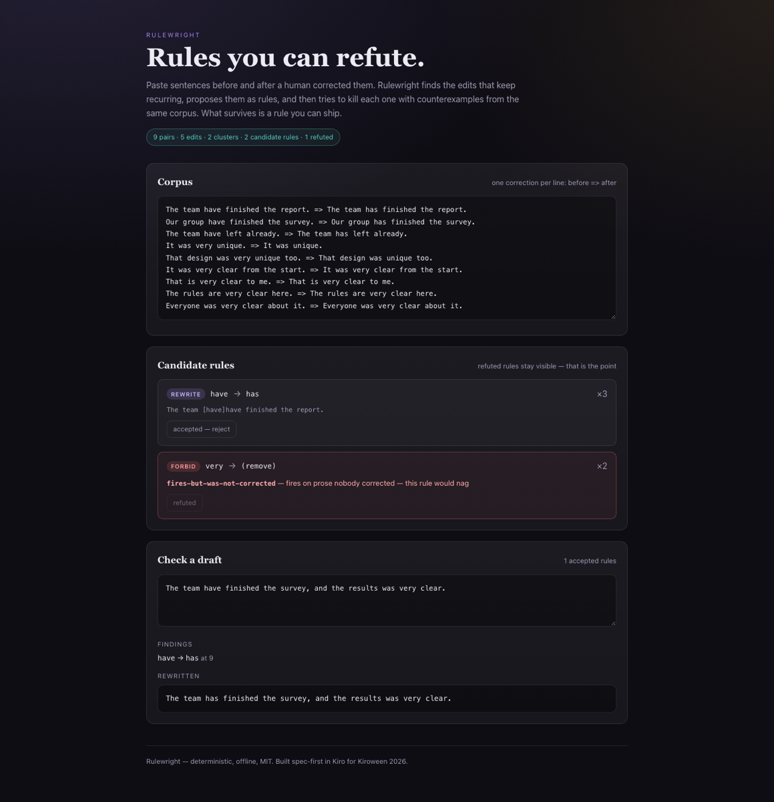

# Rulewright

**Turn recurring corrections into rules you can refute — then ship the survivors.**

You have a pile of sentences before and after someone corrected them. Rulewright finds the edits
that keep recurring, proposes them as rules, and then attacks each proposed rule with
counterexamples taken from the very same corpus. What survives is a rule you can actually trust.

```
corpus  →  diff  →  cluster  →  induce  →  refute  →  you decide  →  check a draft
```

Built for the Kiroween 2026 hackathon as a single tool. MIT licensed.



## Status

Core engine complete and property-tested (23 tests); the studio UI is next.

```bash
npm install
npm test          # 23 tests, incl. 5 property invariants
npm run typecheck
```

## The interesting part

Mining frequent edits is easy. Knowing which of them are *wrong* is the hard part, so the refuter
is the product:

| Refutation | Meaning |
|---|---|
| `replacement-reintroduces-find` | the rule would loop forever |
| `fires-but-was-not-corrected` | the trigger appears in prose nobody corrected — the rule would nag |
| `conflicts-with-accepted` | two rules disagree about the same span |

```ts
import { diffCorpus, clusterOps, induceRules, refuteRules, applyRules } from '@rulewright/core';

const ops = diffCorpus(pairs);
const rules = induceRules(clusterOps(ops));
const survivors = rules.filter((rule) => !refuteRules([rule], pairs).length);
const { findings, text } = applyRules('The team have left.', survivors);
```

## Kiro usage

Everything here is written spec-first: `.kiro/specs/distiller/` holds the EARS requirements and the
five invariants, `.kiro/steering/` keeps the core pure, `.kiro/hooks/` runs the suite and `tsc` on
save, and `.kiro/agents/rule-refuter.json` is a read-only agent whose only job is to kill rules.
The transcript of that agent run is in `docs/`.

## License

MIT.
